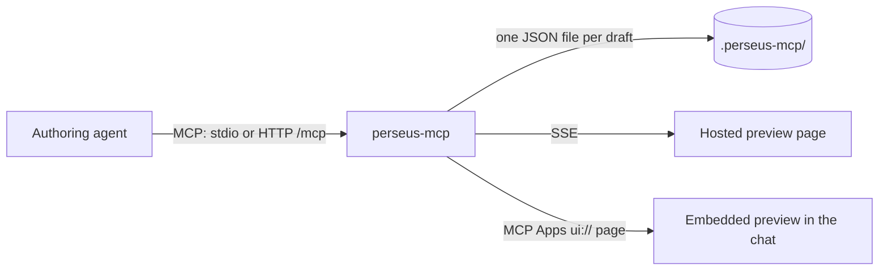

# Perseus MCP plan

A local MCP server in the Perseus monorepo (`packages/perseus-mcp`) that lets
content-authoring agents build, edit, validate, score and preview Perseus
items, using the real Perseus parser, scorer and linter instead of
hand-written JSON. Hackathon project.

## Working agreement

How the work is done. An agent resuming this plan follows these rules exactly.

- **Stop after every commit for review.** Make one small, discrete commit,
  then stop and summarize it so the user can inspect the work and give
  guidance. Don't start the next step until the user says to.
- **Keep this plan current.** Each commit updates this file (Status, the
  commits table, Remaining, and any decision it changes) in the same commit,
  so the plan at any commit describes the branch as of that commit.
- **Work locally only.** Never push, open PRs or offer to open them. The user
  says when.
- **Branch:** `jer/perseus-mcp`, started fresh from `main`. Every commit goes
  on it. The first attempt is kept, unchanged, on `jer/perseus-mcp-backup`
  for reference.
- **Atomic commits.** Each commit is one well-formed change that adds only
  what it uses (dependencies, exports), so `pnpm tsc`, `pnpm fixc`, the
  package's tests and `pnpm knip` all pass at every commit.
- **Don't jump ahead.** Planning questions get answers, not code. Build only
  when the user says to.
- **Commit messages:** one line, no body, as the user's git guide says. The
  commit-msg hook adds a `[jer/perseus-mcp] ` prefix, so keep the subject to
  53 characters (72 in all).
- **Use the repo's tooling, as `AGENTS.md` says.** `pnpm` only: never `npx`,
  `npm` or `pnpm dlx` unless the user says so. Before each commit:
  `pnpm tsc`, `pnpm fixc` (lint and format), the package's tests
  (`pnpm test packages/perseus-mcp`) and `pnpm knip`. When a commit changes
  dependencies, **the user** runs `pnpm add` or `pnpm install`: the sandbox
  blocks the agent's writes to `pnpm-lock.yaml`, and so any `pnpm test` or
  `pnpm exec` whose automatic install needs one.
- **Perseus is open source.** Nothing committed here (this plan included)
  names internal repositories, channels, tickets or infrastructure.

## Status

**Build order steps 1 to 3 are done.** The commits below are on
`jer/perseus-mcp`, oldest first, and every tool was smoke-tested over stdio
from outside the repo.

| Commit | What it adds |
| --- | --- |
| Add perseus-mcp, a local MCP server for Perseus items | The private package in the hexagonal layout: MCP over Streamable HTTP on `/mcp` (Fastify) or over stdio; the file draft repository (drafts parsed on load, bad files skipped); `open_item`, `export_item` and `list_items`, with notes. Root scripts `start-mcp` and `start-mcp:stdio`. The package build skips private packages. This plan. |
| Add widget specs and item validation to perseus-mcp | `list_widgets`, `get_widget_spec`, `validate_item` and the `data-schema.ts` resource. The schema index and widget catalog are domain code, fed by a `SchemaSource` port. |
| Add edit_item to perseus-mcp | `edit_item`: a JSON Patch, new notes or both. Rejected, leaving the draft unchanged, if an operation fails or the result has errors. |
| Add create_item to perseus-mcp | `create_item`: the question and hints as content plus a list of widgets. Each widget's options are merged over its type's defaults and parsed (`buildWidget`), then the item is validated; nothing is saved if anything has errors. |
| Add add_widget to perseus-mcp | `add_widget`: adds a widget to the question or a hint, placing its placeholder right after the `after` text or at the end. The id defaults to the next free one (`nextWidgetId`); options are checked by the parser, as in `create_item`. |
| Add score_item and check_user_inputs to perseus-mcp | `score_item` and `check_user_inputs`, and the `@khanacademy/perseus-score` dependency. User input is parsed with `parseAndMigrateUserInputMap`, and input for a widget the question doesn't have is rejected (`unknown-widget-id`). Each answer gets an outcome: `correct`, `incorrect`, or `invalid` when Perseus wouldn't score it. The locale defaults to `en`. |
| Add review_item prompt and checklist to perseus-mcp | The `review_item` prompt (the review procedure for a draft) and the review checklist resource, built from one list of entries in `src/domain/review/`. `validate_item` issues the checklist explains carry a `see` link to their entry. |
| Add a draft change feed to perseus-mcp | `/drafts/<itemId>/events`: a server-sent event stream of a draft, sent on connect and after every change (`withDraftFeed` wraps the repository, so every save is announced; `watchItem` use case). In stdio mode HTTP runs too, on a free port the OS picks unless `--port` is given, and the process exits when stdin closes. |
| Add @internal/perseus-environment for page setup | `config/environment`, a private package holding the page setup Perseus expects from the sites that host it: the styles Storybook had in `.storybook/styles`, the Lato and Plus Jakarta Sans fonts from `static/`, and the CSS-layer Vite plugin from Storybook's config. Storybook now loads them from it, and the preview will too, so the MCP uses no Storybook code. |
| Add the draft preview page to perseus-mcp | `/drafts/<itemId>/preview`: a shell that follows the draft's event stream and sends the question to a same-origin iframe (`/preview/frame`) through `usePreviewController` and `usePreviewPresenter`; the frame renders it with `Renderer` and MathJax, in the page setup from `@internal/perseus-environment`, and the iframe resizes to fit. Fastify serves the pages with Vite in middleware mode (`@fastify/middie`), so there's no build step; `createHttpServer` takes the pages as an optional `PreviewPages`, faked in the tests. |
| Add preview_item, hints and answer checks | `preview_item`: the URL of a draft's preview page (`PreviewLinks` port, implemented by the HTTP adapter once it's listening; `PreviewUnavailableError` if it never does). The frame renders the whole item with `ServerItemRenderer`, with a "Check answer" button that scores with the same `scoreItem` as `score_item` and shows Perseus's message for the learner, and hints revealed one at a time ("Hide hints" remounts the item, since Perseus can't hide them). |

Remaining, in order:

1. Build order steps 4 to 8. The preview's `renderDone` and `renderError`
   markers (see Preview) aren't built yet; they can come with step 4's
   preview options.

## Notes for whoever picks this up

- **Run it:** `pnpm start-mcp` (HTTP) or `pnpm start-mcp:stdio` from the repo
  root, or `node packages/perseus-mcp/bin/perseus-mcp.mjs` with `--stdio`,
  `--port`, `--data-dir`. HTTP always runs: on port 4567 with `--http`, and
  with `--stdio` on a free port the OS picks (so several sessions can each
  run one), logged to stderr. Drafts are in `.perseus-mcp/` at the repo root.
- **Stdio sessions end when stdin closes:** `main.ts` exits then, because the
  HTTP server would otherwise keep the process alive.
- **The launcher** registers swc itself
  (`register("@swc-node/register/esm", import.meta.url)`), so the server runs
  from TypeScript source in any working directory. A `node -r` or `--import`
  shebang would look swc up from the host's working directory and fail.
- **Code layout:** hexagonal; see Architecture. Ports and other behaviour
  types (`DraftRepository`, `DraftFeed`, `PreviewLinks`, `ItemFileReader`, `SchemaSource`,
  `SchemaIndex`, `WidgetCatalog`, `Catalog`) are `interface`s; data shapes stay `type`.
- **The package** has no `index.ts` or `exports`, and each dependency arrives
  with the commit that first uses it. `package.json` keys follow
  `utils/format-package-json.sh`'s order, but don't run the script on this
  package: it would drop `private` and `bin`. Knip finds the entry point by
  following `bin`; `knip.config.ts` only drops the default `src/index.*`
  pattern, which matches nothing here.
- **SDK imports** go through `src/adapters/mcp/sdk.ts`, because the SDK only
  publishes `.js` subpaths, which the lint rules ban.
- **CommonJS dependencies:** Node's ESM loader can't see `fast-json-patch`'s
  named exports, so `edit.ts` uses its default export.
- **Errors:** the repo's TypeScript `lib` has no `Error` `cause`, so errors
  keep the underlying problem in a `reason` field (`DataDirNotWritableError`,
  `InvalidItemError`).
- **Widget specs** come from perseus-core's `data-schema.ts` and
  `validation.types.ts`, read with the TypeScript compiler API (syntax tree
  only). The widget list comes from the schema's `PerseusWidgetTypes`, not
  the core registry, which lacks free-response.
- **Widget registration:** `CoreWidgetRegistry.registerCoreWidgets()` runs
  once in the composition root (and in the tests that need it), never when a
  module loads.
- **Building widgets:** `buildWidget` merges options over the registry's
  defaults, then parses the result with `parseAndMigratePerseusRenderer`: no
  `as` cast, and always the latest form. Some widgets' defaults don't parse
  on their own (free-response's lack required fields), so that parse can
  fail, and the error is returned.
- **The parser** already rejects a widget whose `type` doesn't match its id
  prefix, so `validate_item` doesn't repeat that check. `collectRenderers`
  keeps its own recursion rather than `traverse`, which doesn't say where a
  nested renderer is; issues need JSON paths.
- **Tests** use `@jest-environment node` and the perseus-core widget
  generators. Use-case tests use `in-memory-draft-repository.testutils.ts`.
  Tests that need widget data use the real perseus-core schema through
  `createCatalog(createPerseusCoreSchemaSource())`, and call
  `CoreWidgetRegistry.registerCoreWidgets()` first. The shared Jest setup
  turns on fake timers before every test, which stalls real network I/O, so
  tests that listen on a port call `jest.useRealTimers()` first. Fastify's
  `inject` can't load under Jest (its `cookie` dependency is ESM-only); use a
  real `listen({port: 0})` and `fetch`.
- **Smoke-test over stdio** from outside the repo before each commit: pipe
  JSON-RPC lines into
  `node packages/perseus-mcp/bin/perseus-mcp.mjs --stdio --data-dir <temp dir>`.
  Jest runs everything as CommonJS, so it misses ESM import and loader
  problems: the launcher and `fast-json-patch` crashes both passed the tests.
- **The preview pages** (`src/adapters/preview/page/`) load through Vite,
  which Jest can't load (Vite 8 is ESM-only), so the HTTP tests fake
  `PreviewPages`; check the real page in a browser before each commit. Script
  paths in the pages' HTML are relative to the page directory (`/shell.tsx`):
  Vite adds the `/preview/` base. Vite defines `process.env.STORYBOOK`, which
  Perseus's and math-input's i18n read on load, so both use their English
  strings. The frame sizes itself from `#root`, because the shared page
  styles stretch the body to the viewport. Editing a page reloads it rather
  than hot-swapping it (the entry modules render the page themselves); that's
  fine, since the draft comes back over the event stream. Vite's file
  watcher doesn't see edits when the server runs inside an agent's sandbox;
  restart it there.
- **Installing:** use `CYPRESS_INSTALL_BINARY=0 pnpm install`. An interrupted
  `pnpm add` can leave packages missing; a full `pnpm install` repairs it.

## At a glance

Agents call tools on the local server, which saves drafts to disk and pushes
each change to every open preview, hosted or embedded.

## Architecture

Hexagonal (ports and adapters): the Perseus logic sits in the middle with no
I/O, and everything that talks to the outside world is an adapter behind a
port. The MCP transport, the draft storage and, later, hosting can change
without touching the core.

- **Domain** (`src/domain/`): pure functions and types: the `Draft` type and
  the item logic in `src/domain/items/`, one module per concern (parsing,
  validation, editing, scoring, ...). No file system, network or process
  access.
- **Ports** (`src/ports/`): the interfaces the core needs, such as
  `DraftRepository`, `DraftFeed`, `PreviewLinks`, `ItemFileReader` and
  `SchemaSource`.
- **Application** (`src/app/`): the use cases behind the tools, prompts and
  resources (drafts, widgets, scoring, review, preview), written against the ports
  only, and `withDraftFeed`, which announces every save on the draft feed.
- **Adapters** (`src/adapters/`): inbound `mcp/` (tool registration, zod
  input schemas, tool results, `INSTRUCTIONS`) and `http/` (Fastify,
  transports, the drafts' event streams and preview pages); `preview/` (the
  pages and Vite); outbound `fs/` (the file draft repository, the item file
  reader, the `data-schema.ts` reader). Later: a hosted draft store.
- **Composition root** (`src/main.ts`): parses arguments, picks the data
  directory default, registers widgets, wires adapters to use cases and
  writes user-facing error messages.

Tool handlers keep only their input schemas and result formatting; everything
else is a use case.

## Decisions so far

An MCP server, not a skill alone: authoring agents won't have a Perseus
checkout, so only a server can run the real parser, scorer and linter for
them.

| Topic | Decision |
| --- | --- |
| Where it runs | Local first: MCP over stdio or local HTTP, with HTTP always running for the preview page. A hosted service later. |
| Architecture | Hexagonal (ports and adapters); see Architecture. |
| Where the code lives | `packages/perseus-mcp` in this monorepo, a private package; run with `pnpm start-mcp`. Published to npm as `@khanacademy/perseus-mcp` once it has been tested in use (build order step 8). |
| Stack | Official TypeScript MCP SDK (`@modelcontextprotocol/sdk`) with Fastify. |
| Data in and out | Raw PerseusItem JSON. Any older Perseus version is accepted; tools always return fully migrated, latest-schema items. Content-backend API access is out of scope. |
| Auth and limits | None. Tools are pure functions over JSON the caller supplies. |
| State | Server-held drafts under an `itemId`; several at once, each with any number of live previews. Saved to disk, one JSON file per draft. Each draft can carry `notes`: context the agent keeps with it. `open_item` and `create_item` take notes, `edit_item` can replace them, and `list_items` shows them. |
| Widgets | All currently supported widgets. free-response: "do not use yet" (unfinished). grapher, plotter, transformer: "avoid if possible" (deprecated; use interactive-graph, including its `none` type for static graphs). group, graded-group, graded-group-set: lower priority. |
| Tool granularity | Build both whole-item tools and fine-grained ones; the eval decides. |
| Widget options and user input in tools | Open objects. Agents learn the shapes from `data-schema.ts` and `validation.types.ts` (`get_widget_spec` and the schema resource), and the tools check what they send with the Perseus parsers, returning their errors. No generated per-widget schemas in the tools' `inputSchema` (see Structured outputs). |
| Linting | `contentType: "exercise"`, locale `en`. `getSaveWarnings` is not used (being deprecated in favour of linting). |
| Images | Any `https` URL in image widgets; the linter flags missing alt text. |
| Preview dependencies | Copy the test/storybook dependencies (`packages/perseus/src/testing/test-dependencies.tsx`) and adjust; this is a dev tool. |
| Page setup | Styles, fonts and CSS layers come from `@internal/perseus-environment` (`config/environment`), shared with Storybook. Being private, it is a dev dependency bundled into any published build, never a runtime one. |
| Perseus changes | Ship as one major changeset, with consuming applications updated in step. |
| Evals | Our own harness on the Claude Agent SDK (see Measurements). |

Drafts and the disk:

- Drafts live in a data directory, by default `.perseus-mcp/` at the repo
  root (gitignored; each worktree has its own), overridable with
  `PERSEUS_MCP_DATA_DIR` or `--data-dir` and created on start. The default is
  chosen in the composition root, not the draft store. If the directory
  isn't writable, startup fails loudly: the repository throws
  `DataDirNotWritableError` and the CLI explains `--data-dir` and
  `PERSEUS_MCP_DATA_DIR`.
- The server runs as the user (Claude Desktop launches it that way), so the
  checkout is writable, and it only ever writes inside the data directory.
- Loading parses and migrates every draft. A file that doesn't parse is
  skipped, logged to stderr and listed under `skipped` by `list_items`.
- `export_item` returns the JSON and the file path rather than writing to
  arbitrary paths.
- Browser localStorage was rejected: only the preview page could read it, not
  the server.
- Hosting later needs a real store, since a hosted service may have no
  persistent disk.

## MCP server and tools

One Fastify process serves MCP over Streamable HTTP on `/mcp` (stateless at
the protocol level; the state is in the draft store), each draft's event
stream on `/drafts/<itemId>/events` and, later, the preview page. `--stdio`
serves MCP over stdio; HTTP still runs alongside it, on a free port, for the
previews. Authoring guidance ships as MCP resources and prompts
and in `INSTRUCTIONS` (the `instructions` field of the MCP initialize result);
an optional thin skill can point Claude Code users at the server.

| Tool | What it does |
| --- | --- |
| `open_item(item or path, notes?)` / `export_item(itemId)` | Load an item into a new draft; return a draft's migrated JSON, notes and file path. |
| `list_items` | List drafts, most recently changed first, with their notes, plus saved files that couldn't be loaded. |
| `list_widgets` / `get_widget_spec(type)` | Status, notes and default options per widget, and its options and user-input types from `data-schema.ts` and `validation.types.ts`. Carries the "do not use yet" and "avoid if possible" flags. |
| `create_item(question, hints?, answerArea?, notes?)` | Build an item from content plus a list of `{id, type, options}` widgets, so the server builds the widgets map: options are merged over the type's defaults and parsed, then the item is validated. |
| `add_widget(itemId, type, options?, id?, hint?, after?)` | Fine-grained: add one widget to the question or a hint, with its placeholder right after the `after` text or at the end. Options are checked by the parser. |
| `edit_item(itemId, patch?, notes?)` | Apply a JSON Patch, then re-validate; rejected, leaving the draft unchanged, if anything fails. This is how the agent carries out a plain-language request ("make choice B correct"). |
| `validate_item(itemId or item)` | Parse and migrate, check placeholders against widget keys, lint. Structured errors with JSON paths; warns on free-response, notes deprecated widgets. |
| `score_item(itemId, userInput, locale?)` | Score one answer to the question with `scorePerseusItem`. Returns the outcome (`correct`, `incorrect` or `invalid`), Perseus's score and each widget's score. |
| `check_user_inputs(itemId, inputs[], locale?)` | Score a batch of agent-written answers, each `{label?, userInput, expected}`. Returns the number of mismatches and each answer's outcome. An answer that can't be scored doesn't match and carries its issues; the rest of the batch still runs. |
| `preview_item(itemId)` | Return the local preview URL; also linked to the embedded MCP Apps page. |
| `create_graphie(spec)` | Build a Graphie image from a declarative spec (see its section). |

Resources and prompts:

- `perseus://schema/data-schema.ts`: perseus-core's `data-schema.ts` text.
- `perseus://guides/review-checklist.md`: the review checklist (see Item
  review).
- The `review_item(itemId)` prompt: the review procedure for a draft.

`check_user_inputs` is for authors testing an item ("give me 5 correct and 5
incorrect guesses"):

- The agent writes the guesses by solving the question from its content:
  correct answers in several equivalent forms (`0.75`, `3/4`) and common
  mistakes, each labelled with its expected result.
- The guesses are not derived from the answer key, so a match tests
  correctness, not just self-consistency.
- A mismatch points to a wrong answer key or a misconfiguration, e.g. "3/4 is
  rejected because only decimal is allowed".
- As with widget options, `userInput` is an open object in the tool's
  schema. `get_widget_spec` gives each widget's user-input type, and
  `parseAndMigrateUserInputMap` checks the input before scoring, so a bad
  shape returns the parser's error. Input for a widget the question doesn't
  have is rejected, since Perseus would silently ignore it.

## Item review

Agents review every item they create or edit before returning it, using
checks drawn from defects that content authors have reported reaching
learners. Mechanical checks become Perseus lint rules, so human authors see
them in the editor's issues panel too. Only checks the linter can't do stay
in `validate_item`, and judgment calls go in the agent's review procedure.

| Pattern reported | Check | Lives in | Status |
| --- | --- | --- | --- |
| Radio with no correct choice | `radio-widget-error` | linter | exists |
| Widget in the question left `static: true`, so it can't be answered | `static-widget-in-question-stem` | linter | exists |
| Sorter over 10 cards, or over 5 in horizontal layout | `sorter-widget-warning` | linter | exists |
| Table with no caption or headers | `table-missing-caption` (more table rules coming) | linter | exists |
| Duplicate radio or dropdown choices (e.g. "A and D are the same") | Compare normalized choice text (trim, ignore `$` and whitespace) | linter: new widget rule | new |
| Untranslatable `https://ka-perseus-graphie…/X.png` image | Suggest `web+graphie://…/X` | linter: new image rule, like `legacy-gif-url` | new |
| Key contradicts the hints (hints say 11 cm, key says 16 cm) | Score the numbers and math in the last hint; warn if none score correct | `validate_item`: needs the question's widgets and the scorer, which a lint rule doesn't have | new, warning only |
| Placeholder with no widget, widget never placed, placeholder used twice, widget id that won't render | Compare the content's placeholders with the widgets map | linter: new rules, built on this branch in build step 4; `validate_item` until then | new |
| free-response, or an avoid-if-possible widget | Notes from `get_widget_spec` | `validate_item` | exists |

**Review procedure** (the agent's judgment):

1. Run `validate_item`. Fix every error, and fix or explain each warning.
2. Solve the question from its text alone, before reading the key. A
   different answer is a finding.
3. Read the wording as a learner would: rounding, units, the requested form,
   thousands separators, equivalent forms. Example: "round to the nearest
   thousand" with a key of `19` while learners type `19000`. Label each
   likely input with your own solution and run `check_user_inputs`.
4. Check that the last hint gives the same answer as the key and your
   solution. If not, solve again to decide which is wrong.
5. Check that every interactive widget can be answered and is graded as
   intended, and that static and ungraded widgets are deliberate.
6. Test several equivalent forms of complex expressions. The expression
   scorer (KAS) can reject valid ones. Report any it rejects.
7. If the author's intent is unclear, ask or report. Don't guess.

The review returns `{guesses, findings: [{widget, kind, witness, note}]}`,
the same shape as the eval's check-inputs report. Finding kinds are the
checklist's entry ids (`no-correct-answer`, `duplicate-choices`,
`key-contradicts-hints`, `wording-invites-rejected-answer`,
`correct-rejected`, `incorrect-accepted`, `unanswerable`, ...).

The procedure ships once, as the `review_item` MCP prompt plus the checklist
resource, with a check and a short example per entry. Both are built from
one list (`CHECKLIST` in `src/domain/review/checklist.ts`), which also maps
`validate_item` issue codes to entries: an issue the checklist explains
carries a `see` link to it. `INSTRUCTIONS` tells agents to review every item
they create or edit. The optional Claude Code skill only points to these, so
the two can't drift apart.

## Preview

The same preview is delivered two ways: a hosted page any browser (or agent
with a browser) can open, and an embedded page shown inside the chat where
the host supports MCP Apps.

**Hosted preview page.** A Vite/React app served by Fastify at
`http://localhost:<port>/drafts/<itemId>/preview`, built just for this MCP.

- Fastify runs Vite in middleware mode (through `@fastify/middie`), which
  compiles the page from source on request, like the server itself: no
  build step to forget, at the cost of a slower first load. A prebuilt
  bundle was rejected for development because every change would need a
  rebuild; a published package will need one (build order step 8).
- A top-level shell follows the draft over SSE and runs
  `usePreviewController`; an iframe on the same origin runs
  `usePreviewPresenter` and renders with ServerItemRenderer. Same origin
  means today's hooks work unchanged.
- Includes hints and check-answer. Hints are revealed one at a time,
  following `Hint.replace` (a replacing hint takes the place of the one
  before it). Until step 4's `reveal-hint` message, the buttons live in the
  frame, next to `ServerItemRenderer`; check answer scores with the same
  `scoreItem` as `score_item`, so the two always agree.
- Like the render pages consuming applications use for screenshots, it sets
  `body.dataset.renderDone` and `body.dataset.renderError` markers.
- A dedicated page avoids the same-origin limits of existing editor preview
  frames.

Features, all set through preview options rather than the page's own chrome:

- `showSolutions` / `reviewMode`, to show the correct answer and rationales
- answerless rendering via `splitPerseusItem`, to confirm learners can't see
  answers
- axe-core accessibility scan results (the presenter already has this)
- linter warnings shown inline
- locale and RTL
- dark mode
- read-only mode
- a "copy current item JSON" button

Mobile/touch mode and the math keypad are dropped for now.

**Embedded MCP Apps page.** MCP Apps lets a tool come with a small web page
that the chat app shows inside the conversation.

- The server registers a `ui://` page; `preview_item` links to it through
  `_meta.ui.resourceUri`. When the agent calls the tool, the host loads the
  page in a sandboxed frame and hands it the tool result.
- The page acts as the controller and frames the localhost presenter. That
  is cross-origin, so it needs the target-origin hook change.
- It can call our tools back ("Check answer" via `score_item`) and send
  context to the chat.
- It must be one self-contained file and declare every outside domain in its
  CSP: `ka-perseus-graphie.s3.amazonaws.com`, `cdn.kastatic.org` and the
  local server.
- Confirmed host: Claude Desktop.

## Preview messaging (Perseus hook changes)

All preview communication uses the existing hooks, `usePreviewController`
and `usePreviewPresenter` in `packages/perseus-editor/src/preview/`. Three
Perseus changes make them work across origins and add hint control.

1. **Configurable target origin.** Today both hooks post to `"/"`, which
   means same-origin only. The presenter accepts messages from any origin
   (the content is public JSON); the controller targets the iframe's actual
   origin.
2. **Configuration always comes from messages.** The presenter stops reading
   `window.frameElement.dataset`, which is null when the parent is on
   another origin.
    - A `previewOptions` object rides in `iframe-init`, which the controller
      already re-sends on every `iframe-ready`.
    - Later changes use a new `set-preview-options` message holding a
      partial `PreviewOptions`; it replaces `set-a11y-scanning-enabled`.
    - `PreviewOptions`: `isMobile`, `hasLintGutter`, `a11yScanningEnabled`,
      `reviewMode`, `showSolutions`, `showRationales`, `answerless`,
      `locale`, `colorScheme`, `readOnly`.
    - The presenter's return values stay the same, so existing preview frame
      pages in consuming applications keep working. `PreviewWithIframe`
      sends these in init instead of `data-*` attributes.
    - Query params were rejected: a second source of truth, and changing
      them reloads the page.
3. **A `reveal-hint` message:** `{type: "reveal-hint", hintsVisible?: number}`,
   the same term and meaning as HintsRenderer's `hintsVisible` prop
   (`packages/perseus/src/hints-renderer.tsx`).
    - `hintsVisible` is a count: 0 = none, n = the first n hints, -1 = all.
      Leave it out to reveal the next hint; set it to jump to that count.
    - HintsRenderer's behaviour is kept as is: a jump of more than one enters
      final-help-page mode, where `replace` is ignored and every revealed
      hint shows. The preview page shows a notice when that happens.
    - HintsRenderer never leaves that mode, so whenever hint state moves
      backwards the preview remounts its whole render tree under a new
      `key`. That also clears entered answers and scores.
    - The presenter replies with
      `{type: "hints-state", hintsVisible, total, visibleCount, isFinalHelpPage}`.
      `visibleCount` reflects `replace` (e.g. 3 revealed but 2 shown).

The changes follow the existing naming: kebab-case message types, camelCase
fields.

## Structured outputs and JSON Schema

**Decided (with `add_widget`):** the MCP tools take widget options as open
objects. Agents learn the shapes from `data-schema.ts` (through
`get_widget_spec` and the schema resource), and the tools validate what they
get with the Perseus parser and return its errors. What follows stays an
option for the eval harness's schema variants only.

Generate a JSON Schema from `data-schema.ts` at build time (e.g. with
`ts-json-schema-generator`), serve it as a resource, and use it as the tools'
`inputSchema`. Strict, schema-constrained generation can't take the whole
item schema as is:

- **No recursive types.** group and graded-group options are a
  `PerseusRenderer`, which contains widgets again.
- **Every object needs `additionalProperties: false`.** That rules out the
  `widgets` map (keyed by arbitrary ids) and the `images` map.

Workarounds: tools take `widgets` as an array of `{id, ...widget}` and the
server builds the map; nesting is unrolled to a fixed depth;
`add_widget(type, options)` gives each widget a small strict schema. The
group widgets, being lower priority, are left out of the strict tools.

Constrained generation only applies where we make the model call ourselves
(the eval harness). MCP hosts treat `inputSchema` as guidance, so the server
always re-validates with `parseAndMigratePerseusItem`.

## Measurements (eval)

The eval runs authoring tasks through the Claude Agent SDK and grades results
with our own deterministic checks, which double as the server's tests.

- **Setups:** (a) no tools, (b) docs only, (c) the MCP server; N runs per
  task.
- **Schema variants:** (i) raw `data-schema.ts` as context (about 82 KB,
  roughly 20K tokens), (ii) a generated JSON Schema as the tools'
  `inputSchema`, (iii) the same with strict tool use, in the harness only.
- **Guidance:** with and without the review checklist (see Item review),
  separate from the tools axis. Setup (b) gets it as plain text, which shows
  whether gains come from the tools or the advice.
- **Models:** several Claude models at a few effort levels. Report quality
  against cost per completed task, to see whether the tools let a cheaper
  model match a bigger one.
- **Tasks:** creates and edits across all widgets, weighted toward radio,
  image, expression, numeric-input and dropdown. Tasks for the review
  patterns use new instances (injected defects, different numbers and
  topics), not the reported items, so the eval doesn't teach to the test. Two
  or three defect kinds stay out of the checklist (e.g. a `maxError` that's
  too wide) to measure whether the review habit carries over.

Metrics:

- parse success
- placeholder and widget-map consistency
- independently derived correct answers score correct, and distractors score
  incorrect
- linter warning count
- edit accuracy: nothing changed beyond what was asked
- defects found in the agent's own review vs. caught by server warnings;
  patterns agents keep missing are candidates for new lint rules
- turns, tokens and time
- optionally, a human rating of teaching quality

## Build order

Steps 1–3 need no Perseus changes, so building can start there.

1. **Scaffold `packages/perseus-mcp`:** the SDK plus Fastify, a stdio entry
   point and local HTTP on `/mcp`, the on-disk draft store and
   data-directory handling.
2. **Core tools:** open/export/list, `list_widgets` and `get_widget_spec`
   with their flags, `validate_item`, `edit_item`, `create_item`,
   `add_widget`, `score_item` and `check_user_inputs`, plus the
   `review_item` prompt and checklist resource. Unit tests use the widget
   generators; test with Claude Desktop over stdio or local HTTP.
3. **Hosted preview page:** the same-origin shell and iframe described above.
   `preview_item` returns its URL.
4. **Perseus changes**, on this branch (one major changeset, consuming
   applications updated in step): options in init plus `set-preview-options`,
   `reveal-hint` and `hints-state`, a configurable target origin. Then wire
   hint controls and options into the preview page. Separately, as a minor
   changeset: the duplicate-choices, graphie-URL and placeholder lint rules;
   `validate_item` then drops its own placeholder checks.
5. **Embedded MCP Apps page:** the cross-origin case, so it waits on step 4's
   target-origin change.
6. **`create_graphie`:** declarative spec to Graphie image, served locally.
7. **Eval harness** on the Claude Agent SDK with a few smoke tasks, until the
   real task set is ready.
8. **Publish to npm** as `@khanacademy/perseus-mcp`, for Khan Academy
   content authors, once steps 4 to 7 are done and the server has been
   tested in use. It installs and runs with `npx @khanacademy/perseus-mcp
   --stdio` in an MCP host's config.
   - **Build:** bundle everything the server needs and fix its paths for an
     installed package. Today it runs from source with swc (using the root
     `tsconfig.json`), compiles the preview with Vite at request time from
     the root `vite.config.mts`, and loads `@internal/perseus-environment`,
     a private package. The published package gets a compiled server and a
     prebuilt preview bundle with its styles and fonts (the fonts' OFL
     licenses included). Running from the repo keeps Vite middleware mode.
   - **Drafts:** in the user's data directory: `~/Library/Application
     Support/perseus-mcp` on macOS, `$XDG_DATA_HOME/perseus-mcp` (default
     `~/.local/share/perseus-mcp`) on Linux, `%LOCALAPPDATA%\perseus-mcp` on
     Windows. Runs from the repo keep `.perseus-mcp/` at its root.
   - **Releases:** through the existing changesets workflow. The Perseus
     packages it uses are pinned to the versions changesets produces, so a
     Perseus release that changes them releases perseus-mcp too.
   - **Before publishing:** check the `Host` header on HTTP requests (the MCP
     SDK's allowed-hosts option), so a web page can't reach the local server
     through DNS rebinding. Set `engines` to Node 20.11 or later
     (`import.meta.dirname`).

## Graphie images

`create_graphie(spec)` turns a declarative JSON spec into a Graphie image and
returns a `web+graphie://` URL to drop into an image widget. It is for
illustrations; for graphs, `get_widget_spec` steers agents to
interactive-graph.

- **Graphie image:** a label-free SVG plus a Graphie Data JSON (labels and
  axis ranges) that Perseus lays over the SVG at render time, with TeX labels
  translatable per locale. A declarative spec replaces writing the old
  immediate-mode Graphie `.js` source; Graphie 2000 is today's human editor
  for the same output.
- **Drawing:** a declarative Graphie drawing library: shapes on a plane
  (`point`, `segment`, `polygon`, `circle`, `arc`, `sector`, `rightAngle`,
  `plot`, `axes`, `grid`) drawn on a canvas that maps plane units to pixels.
  Label output is partly done; gaps are fine for a hackathon.
- **The spec is JSON**, schema-checked and mapped onto drawing calls by the
  server, so we never run code an agent wrote.
- **Output:** the server writes `HASH.svg`, `HASH-data.json` and the spec
  itself (kept as the source, in place of the old `.js`) into the data
  directory, named by content hash.
- **How Perseus loads it:** `web+graphie://host/path/HASH` resolves to
  `https://host/path/HASH.svg` and `HASH-data.json`
  (`/<locale>/HASH-data.json` for non-`en` locales); see
  `perseus-core/src/utils/util.graphie.ts` and
  `perseus/src/util/graphie-utils.ts`.
- **Local serving, no HTTPS needed:** the SVG goes through
  `dependencies.generateUrl` (`components/image-loader.tsx`), which our
  preview dependencies rewrite to `http://localhost:<port>/graphie/…`. The
  data JSON is fetched with plain `fetch(url)`, so the preview page wraps
  `window.fetch` at startup and applies the same rewrite to our local graphie
  host only. No Perseus change.
- The MCP Apps page declares the local graphie host in its CSP.
- Out of scope: publishing to `ka-perseus-graphie` storage.

## Existing code to reuse

| Need | Code |
| --- | --- |
| Validate and migrate | `parseAndMigratePerseusItem`, `parseAndMigratePerseusRenderer`, `parseAndMigrateUserInputMap` (`perseus-core/src/parse-perseus-json/index.ts`) |
| Types | `perseus-core/src/data-schema.ts`, `perseus-core/src/validation.types.ts` |
| Builders | `perseus-core/src/utils/generators/*`, `generateTestPerseusItem` |
| Nested widgets | `traverse`, `perseus-core/src/traversal.ts` |
| Scoring | `scorePerseusItem`, `validateUserInput` (perseus-score); image has no answer, so it is only validated and linted |
| Linting | `lintPerseusItem` (perseus-linter) |
| Preview messaging | `usePreviewController`, `usePreviewPresenter`, `perseus-editor/src/preview/*` |
| Preview dependencies | `perseus/src/testing/test-dependencies.tsx` |

## Later work

- Write the real eval task set (separate session).
- Host the server as a service, with a real draft store.
- Lint in the context of articles (low value).

## Open questions

- Which hosts besides Claude Desktop show the embedded MCP Apps page?

## Verification

- Unit tests for each tool, using generator-built items.
- Connect the server to Claude Desktop, author an item, and confirm it
  parses, scores as expected and renders in both the hosted and embedded
  previews.
- `pnpm tsc`, `pnpm test packages/perseus-mcp`, `pnpm fixc` and `pnpm knip`.
