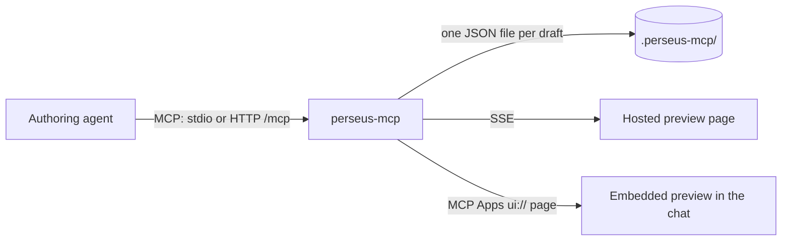

# Perseus MCP plan

A local MCP server in the Perseus monorepo (`packages/perseus-mcp`) that lets
content-authoring agents build, edit, validate, score and preview Perseus
items, using the real Perseus parser, scorer and linter instead of
hand-written JSON. Hackathon project.

## Working agreement

How the work is done. An agent resuming this plan follows these rules exactly.

- **Stop after every commit for review.** Make one small, discrete commit,
  then stop and summarize it so the user can inspect the work and give
  guidance. Don't start the next step until the user says to.
- **Keep this plan current.** Each commit updates this file (Status, the
  commits table, Remaining, and any decision it changes) in the same commit,
  so the plan at any commit describes the branch as of that commit.
- **Work locally only.** Never push, open PRs or offer to open them. The user
  says when.
- **Branch:** `jer/perseus-mcp`, started fresh from `main`. Every commit goes
  on it. The first attempt is kept, unchanged, on `jer/perseus-mcp-backup`
  for reference.
- **Atomic commits.** Each commit is one well-formed change that adds only
  what it uses (dependencies, exports), so `pnpm tsc`, `pnpm fixc`, the
  package's tests and `pnpm knip` all pass at every commit.
- **Don't jump ahead.** Planning questions get answers, not code. Build only
  when the user says to.
- **Commit messages:** one line, no body, as the user's git guide says. The
  commit-msg hook adds a `[jer/perseus-mcp] ` prefix, so keep the subject to
  53 characters (72 in all).
- **Use the repo's tooling, as `AGENTS.md` says.** `pnpm` only: never `npx`,
  `npm` or `pnpm dlx` unless the user says so. Before each commit:
  `pnpm tsc`, `pnpm fixc` (lint and format), the package's tests
  (`pnpm test packages/perseus-mcp`) and `pnpm knip`. When a commit changes
  dependencies, **the user** runs `pnpm add` or `pnpm install`: the sandbox
  blocks the agent's writes to `pnpm-lock.yaml`, and so any `pnpm test` or
  `pnpm exec` whose automatic install needs one.
- **Perseus is open source.** Nothing committed here (this plan included)
  names internal repositories, channels, tickets or infrastructure.

## Status

**Build order steps 1 to 7 and 9 are done; step 8 is next.** The commits below are on
`jer/perseus-mcp`, oldest first, and every tool was smoke-tested over stdio
from outside the repo.

| Commit | What it adds |
| --- | --- |
| Add perseus-mcp, a local MCP server for Perseus items | The private package in the hexagonal layout: MCP over Streamable HTTP on `/mcp` (Fastify) or over stdio; the file draft repository (drafts parsed on load, bad files skipped); `open_item`, `export_item` and `list_items`, with notes. Root scripts `start-mcp` and `start-mcp:stdio`. The package build skips private packages. This plan. |
| Add widget specs and item validation to perseus-mcp | `list_widgets`, `get_widget_spec`, `validate_item` and the `data-schema.ts` resource. The schema index and widget catalog are domain code, fed by a `SchemaSource` port. |
| Add edit_item to perseus-mcp | `edit_item`: a JSON Patch, new notes or both. Rejected, leaving the draft unchanged, if an operation fails or the result has errors. |
| Add create_item to perseus-mcp | `create_item`: the question and hints as content plus a list of widgets. Each widget's options are merged over its type's defaults and parsed (`buildWidget`), then the item is validated; nothing is saved if anything has errors. |
| Add add_widget to perseus-mcp | `add_widget`: adds a widget to the question or a hint, placing its placeholder right after the `after` text or at the end. The id defaults to the next free one (`nextWidgetId`); options are checked by the parser, as in `create_item`. |
| Add score_item and check_user_inputs to perseus-mcp | `score_item` and `check_user_inputs`, and the `@khanacademy/perseus-score` dependency. User input is parsed with `parseAndMigrateUserInputMap`, and input for a widget the question doesn't have is rejected (`unknown-widget-id`). Each answer gets an outcome: `correct`, `incorrect`, or `invalid` when Perseus wouldn't score it. The locale defaults to `en`. |
| Add review_item prompt and checklist to perseus-mcp | The `review_item` prompt (the review procedure for a draft) and the review checklist resource, built from one list of entries in `src/domain/review/`. `validate_item` issues the checklist explains carry a `see` link to their entry. |
| Add a draft change feed to perseus-mcp | `/drafts/<itemId>/events`: a server-sent event stream of a draft, sent on connect and after every change (`withDraftFeed` wraps the repository, so every save is announced; `watchItem` use case). In stdio mode HTTP runs too, on a free port the OS picks unless `--port` is given, and the process exits when stdin closes. |
| Add @internal/perseus-environment for page setup | `config/environment`, a private package holding the page setup Perseus expects from the sites that host it: the styles Storybook had in `.storybook/styles`, the Lato and Plus Jakarta Sans fonts from `static/`, and the CSS-layer Vite plugin from Storybook's config. Storybook now loads them from it, and the preview will too, so the MCP uses no Storybook code. |
| Add the draft preview page to perseus-mcp | `/drafts/<itemId>/preview`: a shell that follows the draft's event stream and sends the question to a same-origin iframe (`/preview/frame`) through `usePreviewController` and `usePreviewPresenter`; the frame renders it with `Renderer` and MathJax, in the page setup from `@internal/perseus-environment`, and the iframe resizes to fit. Fastify serves the pages with Vite in middleware mode (`@fastify/middie`), so there's no build step; `createHttpServer` takes the pages as an optional `PreviewPages`, faked in the tests. |
| Add preview_item, hints and answer checks | `preview_item`: the URL of a draft's preview page (`PreviewLinks` port, implemented by the HTTP adapter once it's listening; `PreviewUnavailableError` if it never does). The frame renders the whole item with `ServerItemRenderer`, with a "Check answer" button that scores with the same `scoreItem` as `score_item` and shows Perseus's message for the learner, and hints revealed one at a time ("Hide hints" remounts the item, since Perseus can't hide them). |
| Send preview messages to the iframe's origin | perseus-editor (major changeset `steady-harbors-listen`, which the next two commits add to): `usePreviewController` posts to the origin of its iframe's `src` instead of `"/"` and accepts messages only from it; `usePreviewPresenter` sends `iframe-ready` to `"*"`, then replies only to the origin of the parent's first message. A cross-origin parent still can't use the presenter until the next commit, because it reads `window.frameElement`. |
| Send preview options to the iframe in messages | `PreviewOptions` and `DEFAULT_PREVIEW_OPTIONS`: `iframe-init` carries `previewOptions`, and `set-preview-options` (some of the options) replaces `set-a11y-scanning-enabled`. The controller's `setPreviewOptions` replaces `setA11yScanningEnabled`; the presenter returns `previewOptions` in place of `isMobile`, `hasLintGutter` and `a11yScanningEnabled`, no longer reads the iframe's `data-*` attributes (`PreviewWithIframe` sends them as options), and checks it's in a frame with `window.parent === window`, so a cross-origin parent works. Checked in Chrome with a frame from `127.0.0.1` inside a page on `localhost`. |
| Add reveal-hint and hints-state to the preview | `reveal-hint` (`hintsVisible?`: a count, -1 for all, left out for the next) and the `hints-state` reply (`HintsState`). The presenter mirrors HintsRenderer's rules in `hints-state.ts` (`revealHints`, `describeHints`): a jump of more than one enters final-help-page mode, `replace` counts only outside it, and hiding hints bumps `renderKey` so the page remounts. It returns `hintsVisible` and `renderKey`; the controller returns `revealHint` and `hintsState`. |
| Show preview hints under their own headings | The frame renders the question with `ServerItemRenderer` and the revealed hints itself, one `HintRenderer` each, in a section below the buttons with a "Hints" heading and a "Hint #n" heading per hint (Perseus's own strings). `replace` still decides which hints show. Hiding hints no longer remounts the item, so the answer survives. |
| Drive preview hints and options from the shell | The shell has hint controls (show next, show all, hide, with the reported `hints-state` and a notice on the final help page) and preview options (review mode, answerless, read only, show solutions), sent with `revealHint` and `setPreviewOptions`. The frame renders what the presenter reports: hints picked with perseus-editor's new `shownHintPositions` (so the rules live in one place), the item split with `splitPerseusItem` when answerless (unless review mode or solutions need the answers), and the other options passed to `ServerItemRenderer`. Check answer stays in the frame. Mobile, locale, color scheme and rationales aren't offered yet. |
| Build the preview shell with Wonder Blocks | The shell uses Wonder Blocks (`View`, `Heading`, `BodyText`, `Button`, `CheckboxGroup`, `SingleSelect` in a `LabeledField`) and the page setup from `@internal/perseus-environment`, with layout in `shell.module.css`; preview options now come before hints. Vite no longer inlines SVGs, as in Storybook: inlined, Wonder Blocks' icons break their CSS and show as squares. |
| Add lint rules for placeholders, choices and Graphie | perseus-linter (minor changeset `calm-rivers-check`): `duplicate-choices` (radio and dropdown, ignoring `$` and spacing), `graphie-image-url` (suggests a `web+graphie://` URL in place of a Graphie PNG), and `widget-placeholder-missing-widget`, `-duplicate` and `-unrenderable`. `validate_item` keeps its own placeholder checks only for renderers nested in widgets, which the linter doesn't visit, plus `orphaned-widget`: a widget that's never placed has no node in the content for a lint rule to report on. The review checklist links the new codes. |
| Move perseus-mcp to the v2 MCP SDK | `@modelcontextprotocol/server` and `@modelcontextprotocol/node` replace `@modelcontextprotocol/sdk` 1.x, as MCP Apps' `ext-apps` 2.x needs. HTTP serves MCP through `createMcpHandler` (stateless, a fresh server per request; it also answers GET and DELETE), stdio through `serveStdio`, and tool and prompt schemas are `z.object(...)`. The `sdk.ts` shim is gone: v2's import paths pass the lint rules. Migrated by hand (the SDK's codemod runs through `npx`). Smoke-tested over stdio from outside the repo and over HTTP. |
| Add an MCP Apps spike that frames the preview | `preview_item` links (`_meta.ui.resourceUri`, plus the deprecated `ui/resourceUri`) to `ui://perseus/preview.html` (`text/html;profile=mcp-app`), whose CSP declares the local server in `frameDomains`. The page (`adapters/preview/app/`) connects with ext-apps' `App`, waits for the tool result and frames its URL, with a status line saying what happened. `createViteAppPage` builds it with Vite on the first request into one document (the script inlined, minified) and caches it; the real page will reuse this. |
| Share the preview's controls with the app page | No change in behavior. The browser preview's option and hint controls move to `page/controls.tsx`, and perseus-editor exports its hint rules (`revealHints`, `describeHints`, `INITIAL_HINTS_REVEAL`), so the MCP Apps page can reuse both. Plan: Claude Desktop refused to let the spike frame `http://localhost`, so the app page renders the item itself; a hosted deployment became a build order step (now step 10). |
| Render the preview inside the MCP Apps page | The app page renders the draft itself: Perseus, MathJax, the shared styles and fonts, Wonder Blocks and the shared controls and `Exercise`, all inlined into one 7.6 MB document. It follows the draft by polling `get_preview_draft`, an app-only tool (`visibility: ["app"]`) that returns the draft or `changed: false`, and keeps hint state with perseus-editor's rules; `preview_item` now also returns the `itemId`. The resource's CSP declares `cdn.kastatic.org` and the Perseus image hosts in `resourceDomains`. Checked in a stand-in host built on ext-apps' `AppBridge` (outside the repo): it renders, follows a new revision, reveals hints and checks answers. |
| Plan packaging perseus-mcp as a .mcpb | Plan only: build order step 6 packages the server as a Claude Desktop extension for testers; the later steps move down one. |
| Find runtime files through RuntimePaths | `RuntimePaths` names the files the server reads at runtime that the installed extension must find too: perseus-core's type definitions (now passed to `createPerseusCoreSchemaSource`) and the default data directory. `checkoutPaths()` gives the repo's; the packaged layout comes with the packaged entry point. The Vite adapters keep finding their sources next to them: they only run from the checkout. |
| Prebuild the preview pages for serving without Vite | `pnpm --filter @khanacademy/perseus-mcp build:pages` builds the browser preview's shell and frame (scripts, styles, fonts under `preview/assets/`) and the MCP Apps page into `dist/pages`; `perseus-mcp --pages <dir>` serves them with `createStaticPreviewPages` and `createStaticAppPage` instead of Vite. The build lives in `scripts/` (tooling, not the server); `productionBuild`, the page folders and the SVG setting move into `vite-shared.ts`. |
| Bundle a packaged perseus-mcp server | `build:mcpb` builds `dist/mcpb/`: `server/index.mjs` (the packaged entry point, `main-packaged.ts`, and every dependency, from Vite's server-side build with `ssr.noExternal`), perseus-core's two type files in `types/`, and the prebuilt pages in `pages/`. `start()` holds the wiring both entry points share; `main.ts` (the repo) passes `checkoutPaths()` and Vite or `--pages`, `main-packaged.ts` passes `packagedPaths()` and the prebuilt pages, so Vite stays out of the bundle. Installed, drafts go in the user's data folder (`userDataDir`), and the server logs where. Run from a copy outside the repo: all tools, the shipped type files, drafts in Application Support, both previews. |
| Pack perseus-mcp into a .mcpb | `build:mcpb` (also `pnpm build:mcpb` at the root) now writes `manifest.json` (MCP Bundle 0.3, generated from perseus-mcp's `package.json`, so the versions match; `node` over stdio; all three platforms; Node 20.11 or later; tools and prompts listed by the server), the repo's `logo.png` as `icon.png`, the MIT `LICENSE` and the fonts' OFL texts (also added next to the fonts in `config/environment`), then runs `mcpb validate` and `mcpb pack` from the `@anthropic-ai/mcpb` dev dependency into `dist/perseus-mcp.mcpb` (7.9 MB). Unpacked outside the repo, the server lists all its tools over stdio. |
| Check the Host header on perseus-mcp's HTTP server | Every HTTP request (MCP, event streams, preview pages and assets) must name an allowed host in its `Host` header or gets a 403, through the MCP SDK's `hostHeaderValidation`, so a web page can't reach a local server through DNS rebinding and read or change drafts. `allowedHostnames(host)` allows localhost's names (`localhost`, `127.0.0.1`, `[::1]`) plus `--host` when it names a host; a wildcard `--host` (`0.0.0.0`, `::`) allows only localhost's names. Checked on the packed server: `localhost` gets 200, another `Host` 403. |
| Ship perseus-mcp to testers as a macOS zip | The organization's extension allowlist keeps Claude Desktop from installing a `.mcpb` that an owner hasn't approved, so testers run the server from a `claude_desktop_config.json` entry instead, and the `.mcpb` (manifest, icon, `@anthropic-ai/mcpb`) is gone. `build:bundle` (renamed from `build:mcpb`) builds `dist/perseus-mcp-macos-arm64.zip`: a `perseus-mcp/` folder with the server, the Node that ran the build (it must be an official macOS arm64 build, 20.11 or later; signed by the Node.js Foundation, so Gatekeeper takes it), Node's license and `INSTALL.md` with the config entry. Only macOS on Apple silicon is supported. Tested in Claude Desktop from `~/Applications/perseus-mcp`: the tools, validation and answer checks, the in-chat preview following edits, and the browser preview. |
| Plan a gutter for the preview's hint labels | Plan only. |
| Show the preview's hint labels | Perseus styles hints only inside an exercise page's `.bibliotron-exercise` container (`perseus-renderer-part-2.css`), as Storybook's hints decorator does: without it, a hint has no border, padding or `position: relative`, and its "n / total" label (`position: absolute; right: 100%`) lands off the page. The preview's hints are now in that container, and both pages leave a 6.4rem gutter at their inline start for the label. Checked in the browser preview. |
| Tell the model what happens in the in-chat preview | The MCP Apps page sends the host a description of the preview whenever it changes (`app.updateModelContext`, when the host supports it): the draft and revision, the last answer checked (Perseus's user input) and its result, the hints revealed and the preview options on. Hosts keep the latest and send it with the person's next message, so they can ask about what they did without Claude calling a tool. `describePreview` (`app/model-context.ts`) writes it; `Exercise` reports each check through `onCheck`. Tested in Claude Desktop: asked what was answered and how many hints were open, Claude knew. |
| Move the preview into @khanacademy/perseus-preview | A new published package (minor changeset `quiet-lanterns-move`) holds what was perseus-editor's `src/preview/` (the message types, validators and sanitizers, `usePreviewController`, `usePreviewPresenter`, the hint rules, the `a11y/` scan and `A11yOverlays`), `PreviewWithIframe`, and the issue types the scan produces (`Issue`, `IssueImpact`, `A11yIssue`, `getIssueKey`, from the editor's `issues-panel.tsx`). perseus-editor depends on it and exports none of it, `Issue` included (major changeset `bright-pebbles-shift`, which lists what to import from where); `axe-core` moves with the scan. It also exports `QuestionPreviewData` and the other `PreviewContent` variants, which the editor's declarations name. Every lower package's lint rules forbid importing it. perseus-mcp's pages import it instead of perseus-editor: the in-chat page goes from 7.59 MB to 6.83 MB. The KaTeX left in it (0.16.9) is mafs's. Also updates two editor snapshots that "Send preview options to the iframe in messages" left stale (the iframe's `data-*` attributes). |
| Inline only woff2 fonts in the in-chat page | `keepWoff2Fonts` (`adapters/preview/woff2-fonts.ts`) removes every source but woff2 from the `@font-face` rules that offer woff2, in the MCP Apps page's built CSS: MathQuill's Symbola came in four inlined formats (woff2, woff, TrueType, IE's eot). The page goes from 6.83 MB to 5.48 MB, and its fonts are all woff2. Checked in the stand-in host: math renders, the woff2 Symbola loads, an answer checks as correct, hints and their labels show, and the model context follows. The browser preview is unchanged: it loads font files, and browsers fetch only the woff2. |
| Mark the preview page when the draft has rendered | perseus-preview (minor changeset `gentle-signals-report`): a `render-state` message from the iframe (`RenderState`: rendering, done, or error with its message, tagged with the content version), `reportRenderState` from the presenter, and the latest `renderState` from the controller, "rendering" from each send until the iframe reports on that content. `Exercise` reports "done" when ServerItemRenderer calls `LoadingContext.onRendered` (images and math settled), remounting the renderer for each item since it reports once per mount, and "error" from an error boundary that shows the message. The shell sets `data-render-done` and `data-render-error` on its body from `renderState` (`page/render-markers.ts`), so a screenshot tool needs only the page's URL; the frame and the in-chat page have no markers, since what drives them already gets the state. Checked in Chrome: the shell is marked done once the math has rendered, and an edit clears the marker until the new revision renders. |
| Build Windows bundles of perseus-mcp for testers | `build:bundle` builds one zip per platform, all by default or the ones named: `perseus-mcp-macos-arm64.zip`, `-windows-x64.zip` and `-windows-arm64.zip`, sharing one build of the server, pages and type files. Every bundle ships the Node version that runs the build: on macOS that binary, and for Windows `node.exe` from Node's official zip for that version, downloaded once into `dist/node-downloads` with curl (which goes through a proxy, unlike Node's fetch) and checked against Node's `SHASUMS256.txt`. Windows install notes give the `%APPDATA%\Claude` config path and the doubled backslashes JSON needs. Checked: each zip's contents (no macOS metadata), `node.exe` is x86-64 or Arm64 and signed by the OpenJS Foundation, and the macOS bundle still runs. Not run on Windows. Plan: the steps from revision history to alt text added before `create_graphie` (now step 12), and the alt-text checks after the build order. |
| Keep every revision of a draft | Build order step 7. Each save also writes `<dataDir>/history/<itemId>/<revision>.json` (revision first, then the draft, each written then renamed), read only when asked for; drafts saved before keep their history from their next revision. Each revision records what made it (`change`: "Created", "Opened from …", "edit_item: 2 operations", "add_widget: radio 1", "Reverted to revision 3"). `DraftRepository` gains `getRevision` and `revisions`; the file adapter reads history only for drafts it knows, so an `itemId` can't name a path outside it. Tools: `list_revisions`, `export_item` with a `revision`, and `revert_item`, which saves an earlier revision's item as the newest revision (keeping the current notes), so a revert can be reverted. Checked over MCP against a dev server. |
| Group drafts into collections, with import and export | Build order step 9. A collection (`domain/collections/`, `<dataDir>/collections/<collectionId>.json` through a `CollectionRepository` port) groups drafts by problem type and holds their ids with the `contentId`s they came with. `import_items` reads a file in any of four shapes (`readImport`): the exercise editor's bulk JSON format, an exercise export (names become notes), items, or a bare renderer; a draft per item that parses, the rest skipped and listed. `export_collection` writes the bulk format through an `ExportFileWriter` port (default `<dataDir>/exports/`, no overwrite unless asked), each item's latest revision as a JSON string. `get_collection`, `list_collections`, `move_items`, `add_to_collection`, `validate_collection`, and `edit_items` (several drafts, each saved or not on its own). Plan: `get_server_info` added as step 8; the later steps move down one. Checked over MCP: perseus-renderer's sample imported, organized into two problem types, exported, and the export re-imported with the same tree. |

Remaining, in order:

1. Step 5 follow-up, shrinking the in-chat page: done for now, at 5.48 MB
   (from 7.6 MB), mostly script: `mathjax-full` 1.4 MB, perseus 0.9 MB,
   `speech-rule-engine` 0.6 MB, mafs's `katex` 0.46 MB, the MCP client
   0.28 MB.

   Not planned: fewer Lato weights (which ones Perseus uses would need
   checking), or dropping the speech rule engine, which reads math to
   screen readers.
2. Build order step 8, then steps 10 to 16.

Consuming applications aren't in this repo: the changesets carry the
migration steps, and they're updated separately.

## Notes for whoever picks this up

- **Run it:** `pnpm start-mcp` (HTTP) or `pnpm start-mcp:stdio` from the repo
  root, or `node packages/perseus-mcp/bin/perseus-mcp.mjs` with `--stdio`,
  `--port`, `--data-dir`. HTTP always runs: on port 4567 with `--http`, and
  with `--stdio` on a free port the OS picks (so several sessions can each
  run one), logged to stderr. Drafts are in `.perseus-mcp/` at the repo root.
- **Stdio sessions end when stdin closes:** `main.ts` exits then, because the
  HTTP server would otherwise keep the process alive.
- **The launcher** registers swc itself
  (`register("@swc-node/register/esm", import.meta.url)`), so the server runs
  from TypeScript source in any working directory. A `node -r` or `--import`
  shebang would look swc up from the host's working directory and fail.
- **Code layout:** hexagonal; see Architecture. Ports and other behaviour
  types (`DraftRepository`, `DraftFeed`, `PreviewLinks`, `ItemFileReader`, `SchemaSource`,
  `SchemaIndex`, `WidgetCatalog`, `Catalog`) are `interface`s; data shapes stay `type`.
- **The package** has no `index.ts` or `exports`, and each dependency arrives
  with the commit that first uses it. `package.json` keys follow
  `utils/format-package-json.sh`'s order, but don't run the script on this
  package: it would drop `private` and `bin`. Knip finds the entry point by
  following `bin`; `knip.config.ts` only drops the default `src/index.*`
  pattern, which matches nothing here.
- **The testers' bundles:** `pnpm build:bundle` (run on macOS on Apple
  silicon; name `macos-arm64`, `windows-x64` or `windows-arm64` to build
  only those) builds `dist/bundle/<platform>/perseus-mcp/` (Node,
  `server/index.mjs`, `types/`, `pages/`, licenses, `INSTALL.md`), laid out
  as `packagedPaths()` expects, and zips each into
  `dist/perseus-mcp-<platform>.zip`. Windows builds download Node's zip once
  into `dist/node-downloads`. Try the macOS one from a copy outside the repo
  with `<copy>/node <copy>/server/index.mjs --stdio`; set `HOME` to a
  scratch folder to keep its drafts apart.
- **Prebuilt pages:** `build:pages` writes `dist/pages/preview/` (the
  shell, the frame and `assets/`) and `dist/pages/preview-app.html`
  (`src/adapters/preview/prebuilt-layout.ts`, kept free of Vite so serving
  doesn't load it). Run `perseus-mcp --pages packages/perseus-mcp/dist/pages`
  to try exactly what the bundle ships. Builds run in production
  mode through `productionBuild` (see below).
- **The MCP Apps page** is built by `createViteAppPage` when a host first
  reads `ui://perseus/preview.html`, and cached:
  - an app build with the script as its only input (a library build isn't
    minified and leaks local paths in comments);
  - with `NODE_ENV` set to `production` for the build, since the browser
    preview's Vite dev server in the same process sets it to `development`,
    which makes any build a development one (React's development
    transform, which names local files);
  - with fonts and images inlined (the page can load only from the hosts it
    declares) and SVGs inlined as base64 (Vite's own inlining keeps the
    SVG's quotes, which break Wonder Blocks' unquoted `url(...)`);
  - inlined into `app/preview-app.html` with replacer functions (the bundle
    contains `$&`, which a replacement string would expand).
  To check it without Claude, build a small host page on ext-apps'
  `AppBridge` that loads the built page in an iframe and answers its tool
  calls.
- **The MCP SDK** is v2: `McpServer`, `createMcpHandler` and types from
  `@modelcontextprotocol/server`, `serveStdio` from
  `@modelcontextprotocol/server/stdio`, `toNodeHandler` from
  `@modelcontextprotocol/node`. Tool and prompt schemas are `z.object(...)`
  (raw shapes are deprecated). v2's Fastify helper, which checks `Host`
  headers, isn't used: `createHttpServer` builds its own Fastify app.
- **CommonJS dependencies:** Node's ESM loader can't see `fast-json-patch`'s
  named exports, so `edit.ts` uses its default export.
- **Errors:** the repo's TypeScript `lib` has no `Error` `cause`, so errors
  keep the underlying problem in a `reason` field (`DataDirNotWritableError`,
  `InvalidItemError`).
- **Widget specs** come from perseus-core's `data-schema.ts` and
  `validation.types.ts`, read with the TypeScript compiler API (syntax tree
  only). The widget list comes from the schema's `PerseusWidgetTypes`, not
  the core registry, which lacks free-response.
- **Widget registration:** `CoreWidgetRegistry.registerCoreWidgets()` runs
  once in the composition root (and in the tests that need it), never when a
  module loads.
- **Building widgets:** `buildWidget` merges options over the registry's
  defaults, then parses the result with `parseAndMigratePerseusRenderer`: no
  `as` cast, and always the latest form. Some widgets' defaults don't parse
  on their own (free-response's lack required fields), so that parse can
  fail, and the error is returned.
- **The parser** already rejects a widget whose `type` doesn't match its id
  prefix, so `validate_item` doesn't repeat that check. `collectRenderers`
  keeps its own recursion rather than `traverse`, which doesn't say where a
  nested renderer is; issues need JSON paths.
- **Tests** use `@jest-environment node` and the perseus-core widget
  generators. Use-case tests use `in-memory-draft-repository.testutils.ts`.
  Tests that need widget data use the real perseus-core schema through
  `createCatalog(createPerseusCoreSchemaSource())`, and call
  `CoreWidgetRegistry.registerCoreWidgets()` first. The shared Jest setup
  turns on fake timers before every test, which stalls real network I/O, so
  tests that listen on a port call `jest.useRealTimers()` first. Fastify's
  `inject` can't load under Jest (its `cookie` dependency is ESM-only); use a
  real `listen({port: 0})` and `fetch`.
- **Smoke-test over stdio** from outside the repo before each commit: pipe
  JSON-RPC lines into
  `node packages/perseus-mcp/bin/perseus-mcp.mjs --stdio --data-dir <temp dir>`.
  Jest runs everything as CommonJS, so it misses ESM import and loader
  problems: the launcher and `fast-json-patch` crashes both passed the tests.
- **The preview pages** (`src/adapters/preview/page/`) load through Vite,
  which Jest can't load (Vite 8 is ESM-only), so the HTTP tests fake
  `PreviewPages`; check the real page in a browser before each commit. Script
  paths in the pages' HTML are relative to the page directory (`/shell.tsx`):
  Vite adds the `/preview/` base. Vite defines `process.env.STORYBOOK`, which
  Perseus's and math-input's i18n read on load, so both use their English
  strings. The frame sizes itself from `#root`, because the shared page
  styles stretch the body to the viewport. Editing a page reloads it rather
  than hot-swapping it (the entry modules render the page themselves); that's
  fine, since the draft comes back over the event stream. Vite's file
  watcher doesn't see edits when the server runs inside an agent's sandbox;
  restart it there.
- **Installing:** use `CYPRESS_INSTALL_BINARY=0 pnpm install`. An interrupted
  `pnpm add` can leave packages missing; a full `pnpm install` repairs it.

## At a glance

Agents call tools on the local server, which saves drafts to disk and pushes
each change to every open preview, hosted or embedded.

## Architecture

Hexagonal (ports and adapters): the Perseus logic sits in the middle with no
I/O, and everything that talks to the outside world is an adapter behind a
port. The MCP transport, the draft storage and, later, hosting can change
without touching the core.

- **Domain** (`src/domain/`): pure functions and types: the `Draft` type and
  the item logic in `src/domain/items/`, one module per concern (parsing,
  validation, editing, scoring, ...). No file system, network or process
  access.
- **Ports** (`src/ports/`): the interfaces the core needs, such as
  `DraftRepository`, `DraftFeed`, `PreviewLinks`, `ItemFileReader` and
  `SchemaSource`.
- **Application** (`src/app/`): the use cases behind the tools, prompts and
  resources (drafts, widgets, scoring, review, preview), written against the ports
  only, and `withDraftFeed`, which announces every save on the draft feed.
- **Adapters** (`src/adapters/`): inbound `mcp/` (tool registration, zod
  input schemas, tool results, `INSTRUCTIONS`) and `http/` (Fastify,
  transports, the drafts' event streams and preview pages); `preview/` (the
  pages and Vite); outbound `fs/` (the file draft repository, the item file
  reader, the `data-schema.ts` reader). Later: a hosted draft store.
- **Composition root** (`src/main.ts`): parses arguments, picks the data
  directory default, registers widgets, wires adapters to use cases and
  writes user-facing error messages.

Tool handlers keep only their input schemas and result formatting; everything
else is a use case.

## Decisions so far

An MCP server, not a skill alone: authoring agents won't have a Perseus
checkout, so only a server can run the real parser, scorer and linter for
them.

| Topic | Decision |
| --- | --- |
| Where it runs | Local first: MCP over stdio or local HTTP, with HTTP always running for the preview page. A hosted service later. |
| Architecture | Hexagonal (ports and adapters); see Architecture. |
| Where the code lives | `packages/perseus-mcp` in this monorepo, a private package; run with `pnpm start-mcp`. Shared with testers as a macOS zip run from Claude Desktop's config (build order step 6), then published to npm as `@khanacademy/perseus-mcp` once it has been tested in use (step 15). |
| Stack | Official TypeScript MCP SDK, v2 (`@modelcontextprotocol/server`, `@modelcontextprotocol/node`), with Fastify. |
| Data in and out | Raw PerseusItem JSON. Any older Perseus version is accepted; tools always return fully migrated, latest-schema items. Content-backend API access is out of scope. |
| Auth and limits | None. Tools are pure functions over JSON the caller supplies. |
| State | Server-held drafts under an `itemId`; several at once, each with any number of live previews. Saved to disk, one JSON file per draft. Each draft can carry `notes`: context the agent keeps with it. `open_item` and `create_item` take notes, `edit_item` can replace them, and `list_items` shows them. |
| Widgets | All currently supported widgets. free-response: "do not use yet" (unfinished). grapher, plotter, transformer: "avoid if possible" (deprecated; use interactive-graph, including its `none` type for static graphs). group, graded-group, graded-group-set: lower priority. |
| Tool granularity | Build both whole-item tools and fine-grained ones; the eval decides. |
| Widget options and user input in tools | Open objects. Agents learn the shapes from `data-schema.ts` and `validation.types.ts` (`get_widget_spec` and the schema resource), and the tools check what they send with the Perseus parsers, returning their errors. No generated per-widget schemas in the tools' `inputSchema` (see Structured outputs). |
| Linting | `contentType: "exercise"`, locale `en`. `getSaveWarnings` is not used (being deprecated in favour of linting). |
| Images | Any `https` URL in image widgets; the linter flags missing alt text. |
| Preview dependencies | Copy the test/storybook dependencies (`packages/perseus/src/testing/test-dependencies.tsx`) and adjust; this is a dev tool. |
| Page setup | Styles, fonts and CSS layers come from `@internal/perseus-environment` (`config/environment`), shared with Storybook. Being private, it is a dev dependency bundled into any published build, never a runtime one. |
| Perseus changes | Ship as one major changeset, with consuming applications updated in step. |
| Evals | Our own harness on the Claude Agent SDK (see Measurements). |

Drafts and the disk:

- Drafts live in a data directory, by default `.perseus-mcp/` at the repo
  root (gitignored; each worktree has its own), overridable with
  `PERSEUS_MCP_DATA_DIR` or `--data-dir` and created on start. The default is
  chosen in the composition root, not the draft store. If the directory
  isn't writable, startup fails loudly: the repository throws
  `DataDirNotWritableError` and the CLI explains `--data-dir` and
  `PERSEUS_MCP_DATA_DIR`.
- The server runs as the user (Claude Desktop launches it that way), so the
  checkout is writable, and it only ever writes inside the data directory.
- Loading parses and migrates every draft. A file that doesn't parse is
  skipped, logged to stderr and listed under `skipped` by `list_items`.
- `export_item` returns the JSON and the file path rather than writing to
  arbitrary paths.
- Browser localStorage was rejected: only the preview page could read it, not
  the server.
- Hosting later needs a real store, since a hosted service may have no
  persistent disk.

## MCP server and tools

One Fastify process serves MCP over Streamable HTTP on `/mcp` (stateless at
the protocol level; the state is in the draft store), each draft's event
stream on `/drafts/<itemId>/events` and, later, the preview page. `--stdio`
serves MCP over stdio; HTTP still runs alongside it, on a free port, for the
previews. Authoring guidance ships as MCP resources and prompts
and in `INSTRUCTIONS` (the `instructions` field of the MCP initialize result);
an optional thin skill can point Claude Code users at the server.

| Tool | What it does |
| --- | --- |
| `open_item(item or path, notes?)` / `export_item(itemId)` | Load an item into a new draft; return a draft's migrated JSON, notes and file path. |
| `list_items` | List drafts, most recently changed first, with their notes, plus saved files that couldn't be loaded. |
| `list_widgets` / `get_widget_spec(type)` | Status, notes and default options per widget, and its options and user-input types from `data-schema.ts` and `validation.types.ts`. Carries the "do not use yet" and "avoid if possible" flags. |
| `create_item(question, hints?, answerArea?, notes?)` | Build an item from content plus a list of `{id, type, options}` widgets, so the server builds the widgets map: options are merged over the type's defaults and parsed, then the item is validated. |
| `add_widget(itemId, type, options?, id?, hint?, after?)` | Fine-grained: add one widget to the question or a hint, with its placeholder right after the `after` text or at the end. Options are checked by the parser. |
| `edit_item(itemId, patch?, notes?)` | Apply a JSON Patch, then re-validate; rejected, leaving the draft unchanged, if anything fails. This is how the agent carries out a plain-language request ("make choice B correct"). |
| `validate_item(itemId or item)` | Parse and migrate, check placeholders against widget keys, lint. Structured errors with JSON paths; warns on free-response, notes deprecated widgets. |
| `score_item(itemId, userInput, locale?)` | Score one answer to the question with `scorePerseusItem`. Returns the outcome (`correct`, `incorrect` or `invalid`), Perseus's score and each widget's score. |
| `check_user_inputs(itemId, inputs[], locale?)` | Score a batch of agent-written answers, each `{label?, userInput, expected}`. Returns the number of mismatches and each answer's outcome. An answer that can't be scored doesn't match and carries its issues; the rest of the batch still runs. |
| `preview_item(itemId)` | Return the local preview URL; also linked to the embedded MCP Apps page. |
| `create_graphie(spec)` | Build a Graphie image from a declarative spec (see its section). |

Resources and prompts:

- `perseus://schema/data-schema.ts`: perseus-core's `data-schema.ts` text.
- `perseus://guides/review-checklist.md`: the review checklist (see Item
  review).
- The `review_item(itemId)` prompt: the review procedure for a draft.

`check_user_inputs` is for authors testing an item ("give me 5 correct and 5
incorrect guesses"):

- The agent writes the guesses by solving the question from its content:
  correct answers in several equivalent forms (`0.75`, `3/4`) and common
  mistakes, each labelled with its expected result.
- The guesses are not derived from the answer key, so a match tests
  correctness, not just self-consistency.
- A mismatch points to a wrong answer key or a misconfiguration, e.g. "3/4 is
  rejected because only decimal is allowed".
- As with widget options, `userInput` is an open object in the tool's
  schema. `get_widget_spec` gives each widget's user-input type, and
  `parseAndMigrateUserInputMap` checks the input before scoring, so a bad
  shape returns the parser's error. Input for a widget the question doesn't
  have is rejected, since Perseus would silently ignore it.

## Item review

Agents review every item they create or edit before returning it, using
checks drawn from defects that content authors have reported reaching
learners. Mechanical checks become Perseus lint rules, so human authors see
them in the editor's issues panel too. Only checks the linter can't do stay
in `validate_item`, and judgment calls go in the agent's review procedure.

| Pattern reported | Check | Lives in | Status |
| --- | --- | --- | --- |
| Radio with no correct choice | `radio-widget-error` | linter | exists |
| Widget in the question left `static: true`, so it can't be answered | `static-widget-in-question-stem` | linter | exists |
| Sorter over 10 cards, or over 5 in horizontal layout | `sorter-widget-warning` | linter | exists |
| Table with no caption or headers | `table-missing-caption` (more table rules coming) | linter | exists |
| Duplicate radio or dropdown choices (e.g. "A and D are the same") | Compare normalized choice text (trim, ignore `$` and whitespace) | linter: `duplicate-choices` | exists |
| Untranslatable `https://ka-perseus-graphie…/X.png` image | Suggest `web+graphie://…/X` | linter: `graphie-image-url` | exists |
| Key contradicts the hints (hints say 11 cm, key says 16 cm) | Score the numbers and math in the last hint; warn if none score correct | `validate_item`: needs the question's widgets and the scorer, which a lint rule doesn't have | new, warning only |
| Placeholder with no widget, widget never placed, placeholder used twice, widget id that won't render | Compare the content's placeholders with the widgets map | linter: `widget-placeholder-*` for the question and hints; `validate_item` for nested renderers and widgets never placed | exists |
| free-response, or an avoid-if-possible widget | Notes from `get_widget_spec` | `validate_item` | exists |

**Review procedure** (the agent's judgment):

1. Run `validate_item`. Fix every error, and fix or explain each warning.
2. Solve the question from its text alone, before reading the key. A
   different answer is a finding.
3. Read the wording as a learner would: rounding, units, the requested form,
   thousands separators, equivalent forms. Example: "round to the nearest
   thousand" with a key of `19` while learners type `19000`. Label each
   likely input with your own solution and run `check_user_inputs`.
4. Check that the last hint gives the same answer as the key and your
   solution. If not, solve again to decide which is wrong.
5. Check that every interactive widget can be answered and is graded as
   intended, and that static and ungraded widgets are deliberate.
6. Test several equivalent forms of complex expressions. The expression
   scorer (KAS) can reject valid ones. Report any it rejects.
7. If the author's intent is unclear, ask or report. Don't guess.

The review returns `{guesses, findings: [{widget, kind, witness, note}]}`,
the same shape as the eval's check-inputs report. Finding kinds are the
checklist's entry ids (`no-correct-answer`, `duplicate-choices`,
`key-contradicts-hints`, `wording-invites-rejected-answer`,
`correct-rejected`, `incorrect-accepted`, `unanswerable`, ...).

The procedure ships once, as the `review_item` MCP prompt plus the checklist
resource, with a check and a short example per entry. Both are built from
one list (`CHECKLIST` in `src/domain/review/checklist.ts`), which also maps
`validate_item` issue codes to entries: an issue the checklist explains
carries a `see` link to it. `INSTRUCTIONS` tells agents to review every item
they create or edit. The optional Claude Code skill only points to these, so
the two can't drift apart.

## Preview

The same preview is delivered two ways: a hosted page any browser (or agent
with a browser) can open, and an embedded page shown inside the chat where
the host supports MCP Apps.

**Hosted preview page.** A Vite/React app served by Fastify at
`http://localhost:<port>/drafts/<itemId>/preview`, built just for this MCP.

- Fastify runs Vite in middleware mode (through `@fastify/middie`), which
  compiles the page from source on request, like the server itself: no
  build step to forget, at the cost of a slower first load. A prebuilt
  bundle was rejected for development because every change would need a
  rebuild; the testers' bundle has one (build order step 6).
- A top-level shell follows the draft over SSE and runs
  `usePreviewController`; an iframe on the same origin runs
  `usePreviewPresenter` and renders with ServerItemRenderer. Same origin
  means today's hooks work unchanged.
- Includes hints and check-answer. Hints are revealed one at a time,
  following `Hint.replace` (a replacing hint takes the place of the one
  before it). Until step 4's `reveal-hint` message, the buttons live in the
  frame, next to `ServerItemRenderer`; check answer scores with the same
  `scoreItem` as `score_item`, so the two always agree.
- Like the render pages consuming applications use for screenshots, the
  shell sets `body.dataset.renderDone` and `body.dataset.renderError`, from
  the frame's `render-state` reports.
- A dedicated page avoids the same-origin limits of existing editor preview
  frames.

Features, all set through preview options rather than the page's own chrome:

- `showSolutions` / `reviewMode`, to show the correct answer and rationales
- answerless rendering via `splitPerseusItem`, to confirm learners can't see
  answers
- axe-core accessibility scan results (the presenter already has this)
- linter warnings shown inline
- locale and RTL
- dark mode
- read-only mode
- a "copy current item JSON" button

Mobile/touch mode and the math keypad are dropped for now.

**Embedded MCP Apps page.** MCP Apps lets a tool come with a small web page
that the chat app shows inside the conversation.

- The server registers a `ui://` page; `preview_item` links to it through
  `_meta.ui.resourceUri`. When the agent calls the tool, the host loads the
  page in a sandboxed frame and hands it the tool result.
- **It renders the item itself** rather than framing the local presenter.
  The spike framed `http://localhost:<port>` and Claude Desktop refused:
  hosts accept only https origins with a dotted name in
  `_meta.ui.csp.frameDomains`, and refuse IP addresses, names without a
  dot and private-network names, so `localhost` can't be declared and the
  page's `frame-src` stays `blob: data:`. Serving the local server over
  https under a public name that resolves to the machine (with a locally
  trusted certificate) might pass, but every author would need that setup
  and Chromium's local-network protections may block it anyway; rejected.
- So Perseus is bundled into the page (one self-contained HTML file, built
  with Vite when a host first asks for it). The page gets the draft through
  `app.callServerTool`, which the host relays to our server, and polls an
  app-only tool to follow edits. Hints, options and Check answer live in the
  page, sharing the browser preview's components.
- It declares the outside hosts it loads from in its CSP
  (`resourceDomains`): `cdn.kastatic.org` (MathJax fonts) and the Perseus
  image hosts.
- A hosted deployment (build order step 16) would give the preview an https
  origin hosts accept, so the page could frame it instead.
- Confirmed host: Claude Desktop.

## Preview messaging (Perseus hook changes)

All preview communication uses the existing hooks, `usePreviewController`
and `usePreviewPresenter` in `packages/perseus-editor/src/preview/`. Three
Perseus changes make them work across origins and add hint control.

1. **Configurable target origin** (done). The controller posts to the
   origin of the iframe's `src` and accepts messages only from it. The
   presenter accepts messages only from `window.parent` (the content is
   public JSON, so any origin may send it), sends `iframe-ready` to `"*"`,
   and replies only to the origin of the parent's first message. A parent
   that navigates to another origin removes the iframe, so that origin
   can't change while the preview runs.
2. **Configuration always comes from messages** (done). The presenter stops reading
   `window.frameElement.dataset`, which is null when the parent is on
   another origin.
    - A `previewOptions` object rides in `iframe-init`, which the controller
      already re-sends on every `iframe-ready`.
    - Later changes use a new `set-preview-options` message holding a
      partial `PreviewOptions`; it replaces `set-a11y-scanning-enabled`.
    - `PreviewOptions`: `isMobile`, `hasLintGutter`, `a11yScanningEnabled`,
      `reviewMode`, `showSolutions`, `showRationales`, `answerless`,
      `locale`, `colorScheme`, `readOnly`.
    - The presenter returns `previewOptions` in place of `isMobile`,
      `hasLintGutter` and `a11yScanningEnabled`, and `PreviewWithIframe`
      sends them as options instead of `data-*` attributes. Consuming
      applications follow the changeset's migration notes.
    - Query params were rejected: a second source of truth, and changing
      them reloads the page.
3. **A `reveal-hint` message** (done; the presenter mirrors HintsRenderer's
   rules in `hints-state.ts`, since it can't read HintsRenderer's state): `{type: "reveal-hint", hintsVisible?: number}`,
   the same term and meaning as HintsRenderer's `hintsVisible` prop
   (`packages/perseus/src/hints-renderer.tsx`).
    - `hintsVisible` is a count: 0 = none, n = the first n hints, -1 = all.
      Leave it out to reveal the next hint; set it to jump to that count.
    - HintsRenderer's behaviour is kept as is: a jump of more than one enters
      final-help-page mode, where `replace` is ignored and every revealed
      hint shows. The preview page shows a notice when that happens.
    - HintsRenderer never leaves that mode, so whenever hint state moves
      backwards the preview remounts its whole render tree under a new
      `key`. That also clears entered answers and scores.
    - The presenter replies with
      `{type: "hints-state", hintsVisible, total, visibleCount, isFinalHelpPage}`.
      `visibleCount` reflects `replace` (e.g. 3 revealed but 2 shown).

The changes follow the existing naming: kebab-case message types, camelCase
fields.

## Structured outputs and JSON Schema

**Decided (with `add_widget`):** the MCP tools take widget options as open
objects. Agents learn the shapes from `data-schema.ts` (through
`get_widget_spec` and the schema resource), and the tools validate what they
get with the Perseus parser and return its errors. What follows stays an
option for the eval harness's schema variants only.

Generate a JSON Schema from `data-schema.ts` at build time (e.g. with
`ts-json-schema-generator`), serve it as a resource, and use it as the tools'
`inputSchema`. Strict, schema-constrained generation can't take the whole
item schema as is:

- **No recursive types.** group and graded-group options are a
  `PerseusRenderer`, which contains widgets again.
- **Every object needs `additionalProperties: false`.** That rules out the
  `widgets` map (keyed by arbitrary ids) and the `images` map.

Workarounds: tools take `widgets` as an array of `{id, ...widget}` and the
server builds the map; nesting is unrolled to a fixed depth;
`add_widget(type, options)` gives each widget a small strict schema. The
group widgets, being lower priority, are left out of the strict tools.

Constrained generation only applies where we make the model call ourselves
(the eval harness). MCP hosts treat `inputSchema` as guidance, so the server
always re-validates with `parseAndMigratePerseusItem`.

## Measurements (eval)

The eval runs authoring tasks through the Claude Agent SDK and grades results
with our own deterministic checks, which double as the server's tests.

- **Setups:** (a) no tools, (b) docs only, (c) the MCP server; N runs per
  task.
- **Schema variants:** (i) raw `data-schema.ts` as context (about 82 KB,
  roughly 20K tokens), (ii) a generated JSON Schema as the tools'
  `inputSchema`, (iii) the same with strict tool use, in the harness only.
- **Guidance:** with and without the review checklist (see Item review),
  separate from the tools axis. Setup (b) gets it as plain text, which shows
  whether gains come from the tools or the advice.
- **Models:** several Claude models at a few effort levels. Report quality
  against cost per completed task, to see whether the tools let a cheaper
  model match a bigger one.
- **Tasks:** creates and edits across all widgets, weighted toward radio,
  image, expression, numeric-input and dropdown. Tasks for the review
  patterns use new instances (injected defects, different numbers and
  topics), not the reported items, so the eval doesn't teach to the test. Two
  or three defect kinds stay out of the checklist (e.g. a `maxError` that's
  too wide) to measure whether the review habit carries over.

Metrics:

- parse success
- placeholder and widget-map consistency
- independently derived correct answers score correct, and distractors score
  incorrect
- linter warning count
- edit accuracy: nothing changed beyond what was asked
- defects found in the agent's own review vs. caught by server warnings;
  patterns agents keep missing are candidates for new lint rules
- turns, tokens and time
- optionally, a human rating of teaching quality

## Build order

Steps 1–3 need no Perseus changes, so building can start there.

1. **Scaffold `packages/perseus-mcp`:** the SDK plus Fastify, a stdio entry
   point and local HTTP on `/mcp`, the on-disk draft store and
   data-directory handling.
2. **Core tools:** open/export/list, `list_widgets` and `get_widget_spec`
   with their flags, `validate_item`, `edit_item`, `create_item`,
   `add_widget`, `score_item` and `check_user_inputs`, plus the
   `review_item` prompt and checklist resource. Unit tests use the widget
   generators; test with Claude Desktop over stdio or local HTTP.
3. **Hosted preview page:** the same-origin shell and iframe described above.
   `preview_item` returns its URL.
4. **Perseus changes**, on this branch (one major changeset, consuming
   applications updated in step): options in init plus `set-preview-options`,
   `reveal-hint` and `hints-state`, a configurable target origin. Then wire
   hint controls and options into the preview page. Separately, as a minor
   changeset: the duplicate-choices, graphie-URL and placeholder lint rules;
   `validate_item` then keeps its own placeholder checks only where the
   linter can't help (nested renderers, widgets never placed).
5. **Embedded MCP Apps page:** Perseus rendered inside the page, fed through
   MCP tool calls (hosts won't let it frame the local server).
6. **Ship to testers** (done) as a macOS zip they unpack and add to
   `claude_desktop_config.json`. The plan was a Claude Desktop extension
   (`.mcpb`), installed with one click, but the organization's extension
   allowlist refuses any `.mcpb` an owner hasn't approved.
   So the zip carries its own Node (an official build, signed by the Node.js
   Foundation), and only macOS on Apple silicon is supported: the build
   ships the Node that runs it. If an owner later allows a custom
   extension, the `.mcpb` build is in this branch's history (commit "Pack
   perseus-mcp into a .mcpb"). Commits:
   1. **Paths by where the server runs** (done): `RuntimePaths` gives the
      files the installed server must find (perseus-core's type definitions,
      the default data directory); `checkoutPaths()` the repo's. The
      packaged layout (`packagedPaths()`) comes with the packaged entry
      point in commit 4. The Vite adapters keep their own paths, since only
      the checkout runs them.
   2. **Drafts in the user's data directory** (done, in commit 4 with the
      packaged entry point that uses it) when installed:
      `~/Library/Application Support/perseus-mcp` on macOS,
      `$XDG_DATA_HOME/perseus-mcp` (default `~/.local/share/perseus-mcp`) on
      Linux, `%LOCALAPPDATA%\perseus-mcp` on Windows. Runs from the repo keep
      `.perseus-mcp/` at its root.
   3. **Prebuilt pages** (done): `build:pages` builds the shell, the frame
      and the MCP Apps page into `dist/pages`; `--pages <dir>` serves them
      without Vite. The pages keep Vite's default browser targets:
      `config/build/browser-targets.ts` has no package export, and importing
      it across packages breaks the lint rules.
   4. **One bundled server file** (done): a packaged entry point
      (`packagedPaths()`, no Vite) bundled with all its dependencies into
      `server/index.mjs` (Vite's server-side build for Node, with
      `ssr.noExternal: true`), since pnpm's `node_modules` is symlinks. It
      includes the TypeScript compiler, which `get_widget_spec` uses; the
      two perseus-core type files ship next to it. Rolldown gives bundled
      CommonJS its own `require()`; `__filename` and `__dirname` (which the
      TypeScript compiler reads) are defined as `import.meta.filename` and
      `import.meta.dirname`, which need Node 20.11.
   5. **Licenses** (done, with the `.mcpb` pack step that commit 7
      removed): the MIT `LICENSE` and the fonts' OFL texts go in the bundle.
   6. **`Host` header check** (done) on HTTP requests, so a web page can't
      reach a tester's local server through DNS rebinding. A wildcard
      `--host` allows only localhost's names; a hosted deployment (step 16)
      will need its own allowed names.
   7. **The macOS zip, tested** (done): `build:bundle` adds Node, its
      license and `INSTALL.md`, and zips the folder with `ditto` (which keeps
      the binary's signature). Checked unzipped and quarantined outside the
      repo, then in Claude Desktop: the tools, the browser preview and the
      in-chat preview.
   - **How it's built:** with the repo's Vite, through its JavaScript API,
     in a `build:bundle` script of perseus-mcp's own (`pnpm build:bundle` at
     the root). It isn't part of `pnpm build`, which builds what's published
     (as browser libraries with external dependencies) and runs in CI.
   - **Windows** (x64 and Arm) bundles are built too, with Node's
     official `node.exe`, but haven't been run on Windows yet.
   - **Not done:** a Linux bundle, and a CI job that builds the zips.
7. **Revision history** (done): every revision of a draft is kept in
   `<dataDir>/history/` (storage efficiency can come later);
   `list_revisions`, `export_item` with a `revision`, and `revert_item`.
   Step 11 needs it.
8. **`get_server_info`:** a tool Claude calls when a person reports a
   problem, returning what we need to diagnose it, for them to send on:
   perseus-mcp's version and the commit it was built from, whether it runs
   from the bundle or the repo and over stdio or HTTP, Node's version, the
   operating system and processor, the drafts folder and how many drafts it
   holds, the HTTP address and whether the preview pages are served, and
   the last few errors (which the server would start keeping in memory,
   perhaps in a commit of its own). No item content. It can't help when
   the server won't start; for that, testers run a diagnostic command from
   the install notes (drafts of a macOS and a Windows command exist, from
   the session that proposed this step; the Windows one is untested).
9. **Collections, with import and export** (done):
   - A collection (`<dataDir>/collections/`) groups drafts by problem type,
     keeping each item's and problem type's `contentId` so an export writes
     it back to the same place. It holds draft ids, not items.
   - `import_items` reads a file path in any of four shapes: a single item
     (or an array), a bare renderer, an exercise export
     (`items[].item_data`), or the exercise editor's bulk JSON format
     (`[{problemType, contentId?, assessmentItems: [{contentId?,
     itemData}]}]`, `itemData` a JSON string or an object). No pasted JSON:
     Claude would have to read all of it.
   - `export_collection` writes that bulk format to a file (never
     overwriting unless asked), each item its latest revision as a JSON
     string, keeping the imported `contentId`s so the exercise editor's
     import treats them as edits.
   - `get_collection`, `list_collections`, `move_items`,
     `add_to_collection`, `edit_items` (many drafts in one call, each saved
     or not on its own) and `validate_collection`. Review stays per item.
10. **The collection page (browser):** the problem types and their items as
   a tree on the left, the selected item's preview on the right, and a file
   upload for loading a collection. Claude edits; the page shows.
11. **Side-by-side comparison:** two drafts, or two revisions of one, next
    to each other in the browser and in the chat, both rendered as on
    mobile (which needs the preview to apply `PreviewOptions.isMobile`).
    A visual comparison first; marking the differences can come later.
12. **Alt text and long descriptions:** Claude infers each image's purpose
    (assessment, instruction, decorative) from the item, writes `alt` and,
    when needed, `longDescription`, or sets `decorative`, and lists the
    purpose it assumed with them for the author to review, without
    stopping to ask while drafting. The rules are the team's alt-text
    instructions (125-character alt text, no dashes, "x axis", no "The
    diagram shows", math in plain English in alt text and in `$...$` in
    long descriptions, `*` bullets, no invented titles, grade-appropriate
    vocabulary, "a point" and "an open point"). The review checklist gains
    the checks those rules imply: nothing that gives away the answer,
    answer choices' descriptions consistent and distinct, and images that
    can't be described without sight flagged. Grade-level vocabulary
    follows the Common Core standards and mathematics glossary, linked,
    not copied. Open: whether to draw on the NWEA Image Description
    Guidelines for Assessments (2021). Its licence reserves all rights, so
    nothing from it is copied into the repo; even summarising it is
    undecided.
13. **`create_graphie`:** declarative spec to Graphie image, served locally,
    with alt text written by step 12's rules.
14. **Eval harness** on the Claude Agent SDK with a few smoke tasks, until the
    real task set is ready.
15. **Publish to npm** as `@khanacademy/perseus-mcp`, for Khan Academy
   content authors, once steps 4 to 14 are done and the server has been
   tested in use. It installs and runs with `npx @khanacademy/perseus-mcp
   --stdio` in an MCP host's config. The build, the data directory and the
   `Host` check come from step 6; what's left:
   - **Releases:** through the existing changesets workflow. The Perseus
     packages it uses are pinned to the versions changesets produces, so a
     Perseus release that changes them releases perseus-mcp too.
   - **Package metadata:** `engines` set to Node 20.11 or later, the `bin`
     pointing at the built server, and `files` listing what ships.
   - **The repo's build:** a public perseus-mcp would be picked up by
     `config/build`'s `getPackageNames`, whose library build is wrong for
     it. Either `build-packages.ts` hands a package to its own build script,
     or perseus-mcp stays private and is published from its built output.
16. **Hosted deployment**, after publishing: run the server as a hosted
    service on an https origin. It needs a shared draft store (a new
    `DraftRepository` adapter), live updates across instances (one
    instance, a pub/sub layer, or polling), OAuth for remote MCP connectors,
    a decision on storing unpublished drafts, and the prebuilt bundles from
    step 6. It would also let the embedded page frame the hosted preview.

## Graphie images

`create_graphie(spec)` turns a declarative JSON spec into a Graphie image and
returns a `web+graphie://` URL to drop into an image widget. It is for
illustrations; for graphs, `get_widget_spec` steers agents to
interactive-graph.

- **Graphie image:** a label-free SVG plus a Graphie Data JSON (labels and
  axis ranges) that Perseus lays over the SVG at render time, with TeX labels
  translatable per locale. A declarative spec replaces writing the old
  immediate-mode Graphie `.js` source; Graphie 2000 is today's human editor
  for the same output.
- **Drawing:** a declarative Graphie drawing library: shapes on a plane
  (`point`, `segment`, `polygon`, `circle`, `arc`, `sector`, `rightAngle`,
  `plot`, `axes`, `grid`) drawn on a canvas that maps plane units to pixels.
  Label output is partly done; gaps are fine for a hackathon.
- **The spec is JSON**, schema-checked and mapped onto drawing calls by the
  server, so we never run code an agent wrote.
- **Output:** the server writes `HASH.svg`, `HASH-data.json` and the spec
  itself (kept as the source, in place of the old `.js`) into the data
  directory, named by content hash.
- **How Perseus loads it:** `web+graphie://host/path/HASH` resolves to
  `https://host/path/HASH.svg` and `HASH-data.json`
  (`/<locale>/HASH-data.json` for non-`en` locales); see
  `perseus-core/src/utils/util.graphie.ts` and
  `perseus/src/util/graphie-utils.ts`.
- **Local serving, no HTTPS needed:** the SVG goes through
  `dependencies.generateUrl` (`components/image-loader.tsx`), which our
  preview dependencies rewrite to `http://localhost:<port>/graphie/…`. The
  data JSON is fetched with plain `fetch(url)`, so the preview page wraps
  `window.fetch` at startup and applies the same rewrite to our local graphie
  host only. No Perseus change.
- The MCP Apps page declares the local graphie host in its CSP.
- Out of scope: publishing to `ka-perseus-graphie` storage.

## Existing code to reuse

| Need | Code |
| --- | --- |
| Validate and migrate | `parseAndMigratePerseusItem`, `parseAndMigratePerseusRenderer`, `parseAndMigrateUserInputMap` (`perseus-core/src/parse-perseus-json/index.ts`) |
| Types | `perseus-core/src/data-schema.ts`, `perseus-core/src/validation.types.ts` |
| Builders | `perseus-core/src/utils/generators/*`, `generateTestPerseusItem` |
| Nested widgets | `traverse`, `perseus-core/src/traversal.ts` |
| Scoring | `scorePerseusItem`, `validateUserInput` (perseus-score); image has no answer, so it is only validated and linted |
| Linting | `lintPerseusItem` (perseus-linter) |
| Preview messaging | `usePreviewController`, `usePreviewPresenter`, `perseus-editor/src/preview/*` |
| Preview dependencies | `perseus/src/testing/test-dependencies.tsx` |

## Later work

- Write the real eval task set (separate session).
- Lint in the context of articles (low value).
- Share the SVG inlining setting. Vite inlines small SVGs as an unquoted
  `url(data:...)`, which the quotes in Wonder Blocks' icons break, so the
  icons show as squares. Storybook (`.storybook/main.ts`) and the preview
  (`vite-preview-pages.ts`) each turn inlining off for SVGs; move that into
  one shared place, such as the root `vite.config.mts` or
  `@internal/perseus-environment`. (Not reported to Vite, by decision.)
- Drop `validate_item`'s placeholder checks for nested renderers once the
  linter lints them; a teammate is adding that recursion to the linter.
  Only `orphaned-widget` stays.
- Limit which sites can embed the preview frame, with a
  `Content-Security-Policy: frame-ancestors` header on the frame's response
  (`'self'`, plus the MCP Apps host once there is one). Not needed for
  safety: the presenter only talks to the window that embeds it, so another
  site embedding the frame can only preview content it sends itself.

- Revisit the `graphie-image-url` lint rule's scope, which may overshoot:
  - It checks only image widgets (not markdown images), and only `.png`s on
    the `ka-perseus-graphie` host. Which of Perseus's image forms should it
    cover?
  - It warns on every such image, but labels only need translating when the
    image has text labels; for many images a clear alt text is enough.
    Should it apply only to images with labels, or be a guideline rather
    than a warning?

## Alt-text checks (after the build order)

Checks code does better than Claude, for the alt text step 12 writes:

- Alt text of 125 characters or less, in `validate_item` and possibly as a
  perseus-linter rule.
- No dashes, "x axis" rather than "x-axis", and no opening "The diagram
  shows" or "The diagram uses".
- A `readability` tool that computes Flesch-Kincaid grade level, Gunning fog
  and Coleman-Liau scores for a description, when the author asks for them.

## Open questions

- Which hosts besides Claude Desktop show the embedded MCP Apps page?

## Verification

- Unit tests for each tool, using generator-built items.
- Connect the server to Claude Desktop, author an item, and confirm it
  parses, scores as expected and renders in both the hosted and embedded
  previews.
- `pnpm tsc`, `pnpm test packages/perseus-mcp`, `pnpm fixc` and `pnpm knip`.
